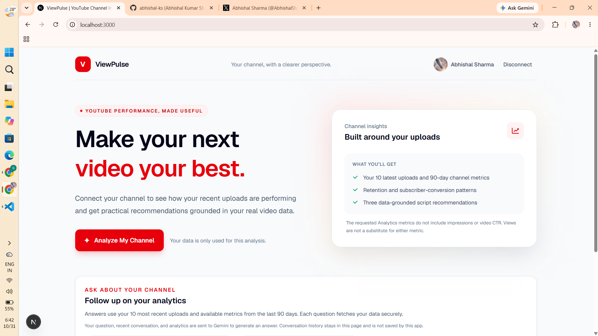
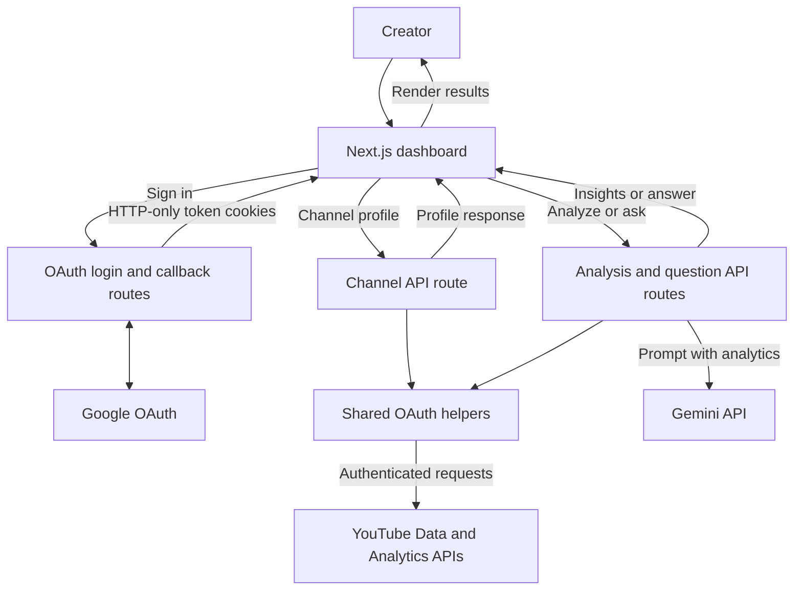

# ViewPulse

ViewPulse connects a YouTube channel with read-only Google OAuth access, retrieves its 10 most recent uploads and their last 90 days of video-level analytics, and generates a performance breakdown with Gemini.



## Design and architecture

The browser renders the dashboard and makes same-origin requests to Next.js API routes. OAuth tokens remain in HTTP-only cookies; the server uses them to fetch YouTube data and calls Gemini for analysis and answers.



## Configure Google and Gemini

Create OAuth 2.0 credentials in the [Google Cloud Console](https://console.cloud.google.com/):

1. Enable the **YouTube Data API v3**.
2. Configure the OAuth consent screen and add your account as a test user if the app is in testing.
3. Create a **Web application** OAuth client and add `http://localhost:3000/api/auth/callback` as an authorized redirect URI.
4. Create a Gemini API key in [Google AI Studio](https://aistudio.google.com/apikey).

Add these values to `.env.local` in the project root:

```env
GOOGLE_CLIENT_ID=your-google-oauth-client-id
GOOGLE_CLIENT_SECRET=your-google-oauth-client-secret
GOOGLE_REDIRECT_URI=http://localhost:3000/api/auth/callback
GEMINI_API_KEY=your-gemini-api-key
```

Never expose these values through `NEXT_PUBLIC_` variables or commit `.env.local`. In production, set `GOOGLE_REDIRECT_URI` to the deployed HTTPS callback URL and add that exact URI to the Google OAuth client. Cookies are marked `Secure` automatically in production.

## Run locally

```bash
npm run dev
```

Visit [http://localhost:3000](http://localhost:3000), sign in with Google, and choose **Analyze My Channel**. The access and refresh tokens are stored in HTTP-only, same-site cookies and are never sent to client-side JavaScript. If you connected before the YouTube Analytics scope was added, disconnect and sign in again to grant it.

## API

- `GET /api/auth/login` starts the Google OAuth flow with a CSRF-protected state value.
- `GET /api/auth/callback` exchanges the authorization code and stores OAuth tokens.
- `GET /api/auth/channel` returns the signed-in YouTube channel name and profile image without exposing OAuth tokens to the browser.
- `POST /api/analyze` retrieves 10 recent uploads, merges 90-day video-level views, watch time, retention, subscriber gains, likes, comments, and shares, then returns Gemini insights and script recommendations.
- `POST /api/ask` accepts a question and a bounded conversation history, retrieves the signed-in user's recent upload analytics on the server, and returns a Gemini answer grounded in those metrics. Suggested questions fill the input for the user to review before sending.
- `POST /api/auth/logout` clears the local OAuth cookies.

The report includes a watch-time efficiency estimate (watch minutes divided by views times video duration). The requested report metrics do not include impressions or click-through rate (CTR), so the analysis does not infer either from views. Analytics values may be absent for videos without report data in the selected period. Follow-up questions use the same 10-upload and 90-day limits; recent conversation messages are sent only as bounded context and are not treated as a source of analytics facts. Questions, recent conversation context, and analytics are sent to Gemini for answers; conversation history is held in page memory and is not saved by this app.
